# 同一个AI，换医院就不准？

看懂换环境为何掉分，以及怎样借助区域关系稳住判断。

## 一页读懂

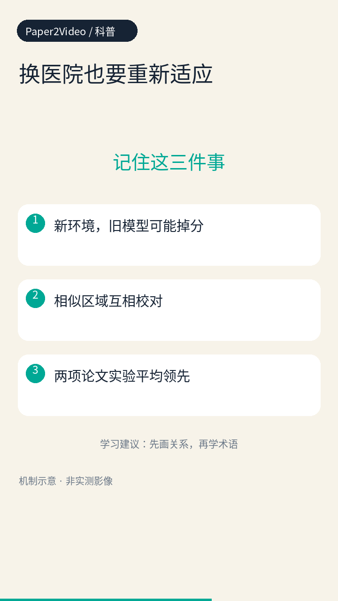

- 新环境，旧模型可能掉分

- 相似区域互相校对

- 两项论文实验平均领先

学习建议：先画关系，再学术语

## 同一个AI，换医院就不准？

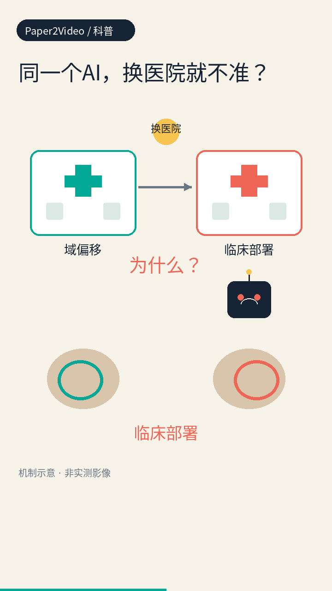

同一个AI，为什么换医院就不准？它负责在图片里圈出目标，但拍摄风格一变，就可能圈错。

原文依据：第1页。

## 旧办法要旧数据

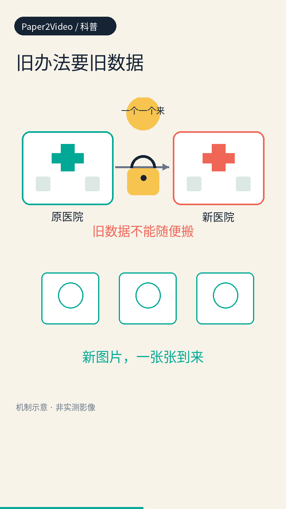

旧办法要旧数据，可病人隐私不让给，测试样本还一个一个来，根本凑不齐。

原文依据：第1页。

## 自己猜会越猜越错

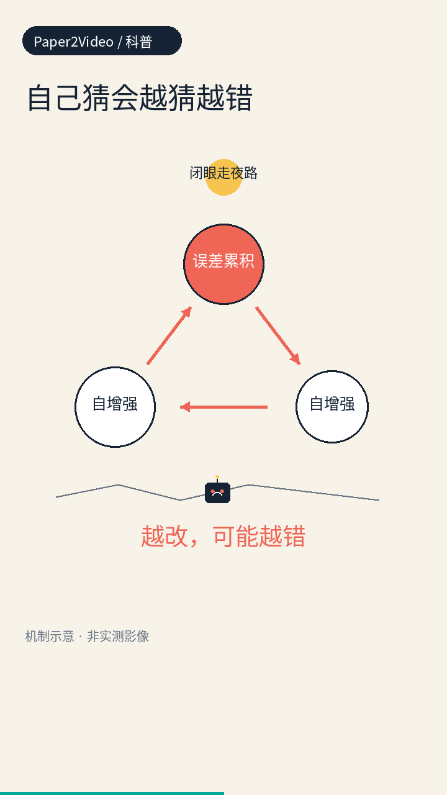

旧办法若只信自己的猜测，就像闭眼走夜路，错一步还沿着错方向走，误差越滚越大。

原文依据：第1、2页。

## 先挑有把握的区域

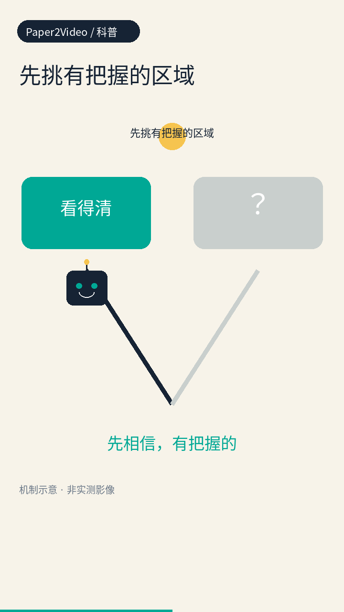

先挑有把握的区域，就像先看清晰路牌再认路，模糊的地方先放一放。

原文依据：第3页。

## 把相似区域拉成组

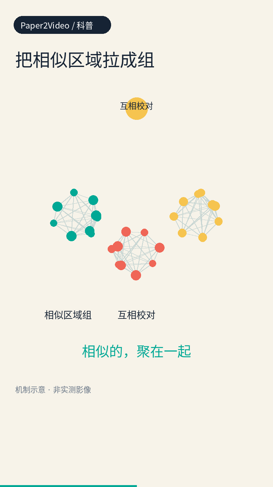

再把相似区域拉成一组，让同一组互相校对，别只信自己单点猜测。

原文依据：第1、2页。

## 旧经验和新差异分开

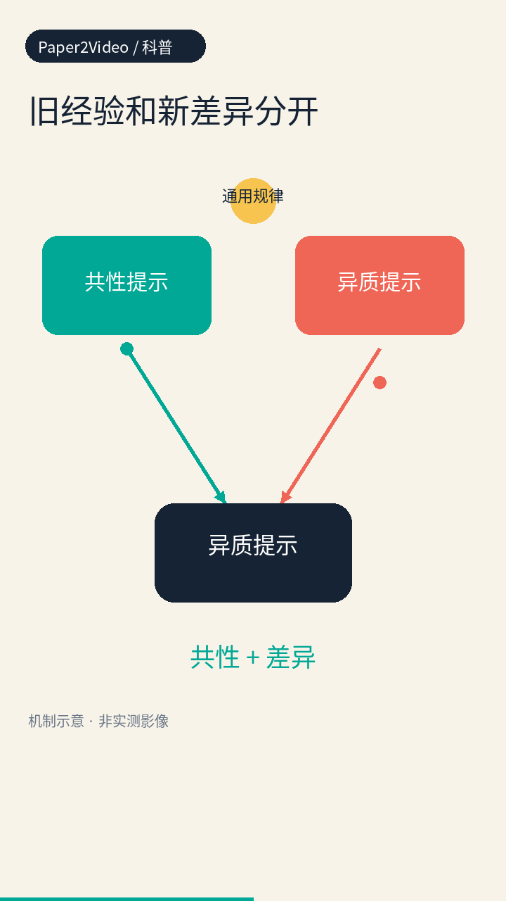

旧经验和新差异分开存，就像老医生记得通用规律，也留意这家医院的特殊习惯。

原文依据：第1、3页。

## 同组校对，少走弯路

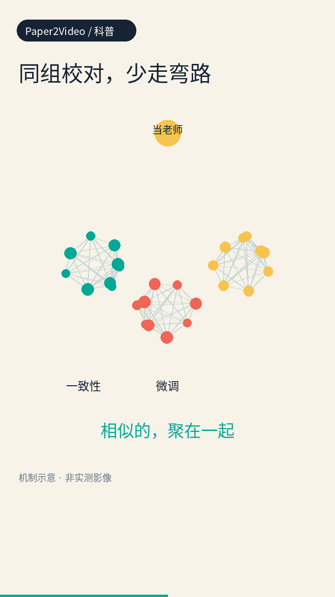

组内预测要一致，用这个一致性当老师，悄悄微调模型，不靠旧数据标签。

原文依据：第1、5页。

## 两股力量一起拉

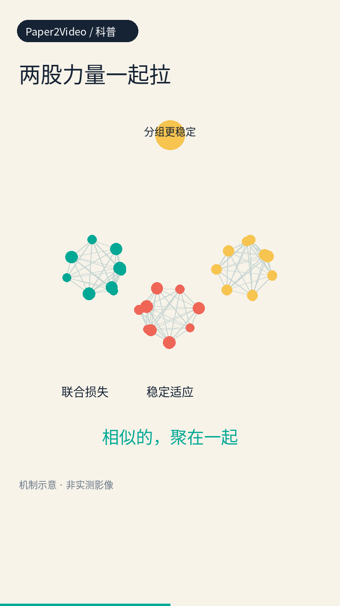

一边让相似区域的判断保持一致，一边让分组更稳定，两道检查一起减少乱改。

原文依据：第5页。

## 眼底分割平均分

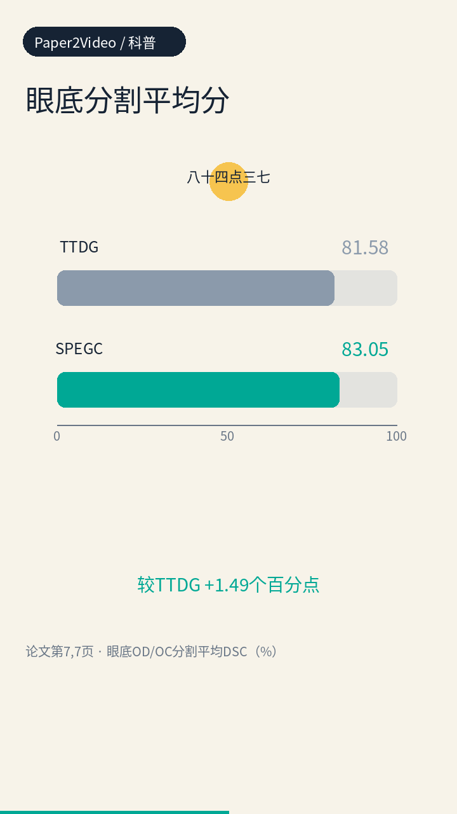

眼底分割实验中，区域重叠分平均八十四点三七，比对比方法高一点四九个百分点。

原文依据：第7页。

## 息肉分割平均分

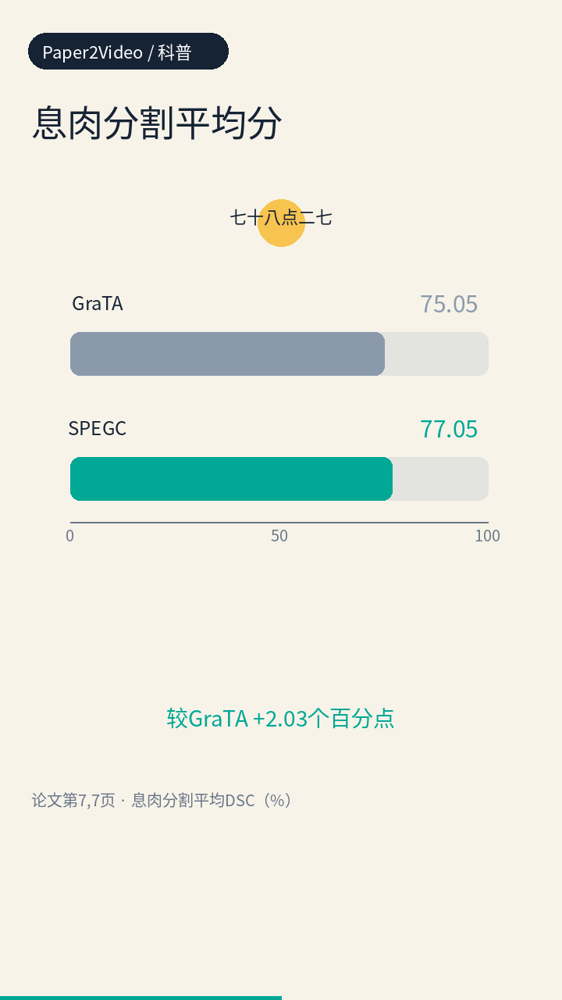

息肉分割实验中，区域重叠分平均七十八点二七，比对比方法高二点零三个百分点。

原文依据：第7页。

## 不靠猜，靠结构

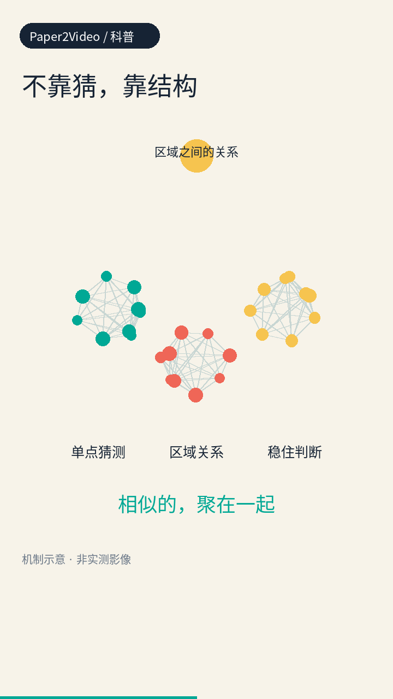

亮点是不只靠单点猜测，而是看区域之间的关系，用结构来稳住判断。

原文依据：第1、2页。

## 能帮上忙但没落地

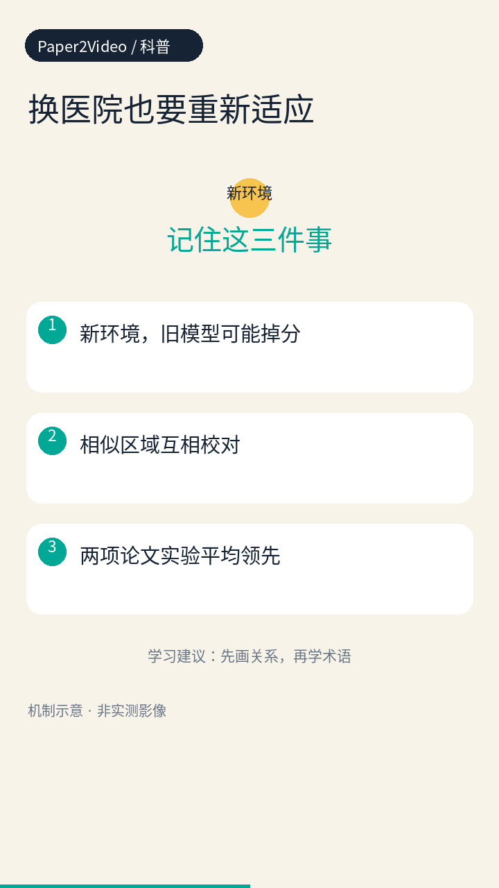

换医院，需要适应新环境。论文在公开数据集上改善了分割，但未报告临床验证，建图也更费计算。

原文依据：第1、8页。

示意动画用于解释机制，不能当作真实实验影像；研究结果不等于临床验证。
